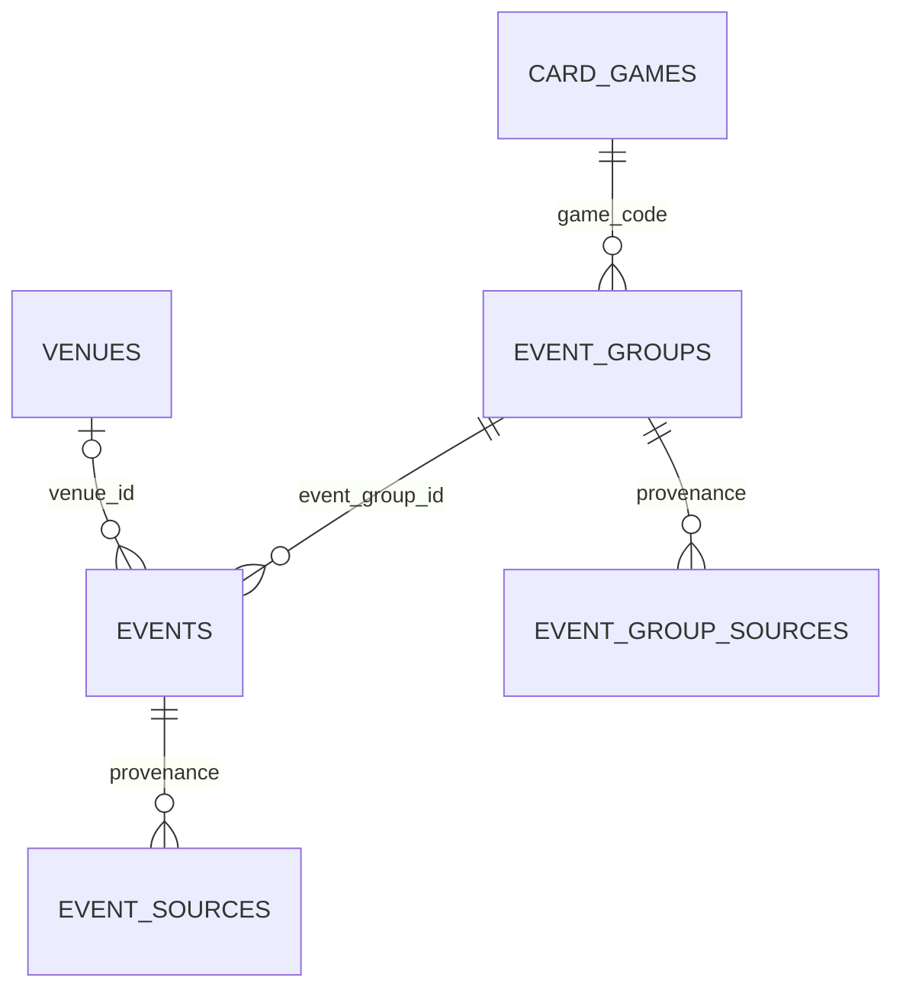

# 赛事数据表设计（草案）

状态：2026-11-17，来源调查与逻辑设计，尚未创建数据库、migration、采集器或页面。

## 1. 官网实际结构

| 游戏 / 页面 | 已观察到的结构 | 对模型的影响 |
| --- | --- | --- |
| ONE PIECE [Standard Battle 2026/12](https://www.onepiece-cardgame.com/events/standardbattle-202612.html) | 12/1–12/31，全国公认门店，共通规则与奖品，报名链接指向 TCG+ `/series/8608` | 这是一组活动。月度起止日属于 group；每家店每个具体举办场次属于 event。 |
| ONE PIECE [交流会 2026/12](https://www.onepiece-cardgame.com/events/meetup-202612.html) | 相同月份与全国范围，独立的活动内容和奖品，TCG+ `/series/8609` | 与 Standard Battle 是两个 group；不能按游戏+月份合并。交流活动也必须能收录。 |
| ONE PIECE [Fan Festa 2026](https://www.onepiece-cardgame.com/events/fanfest-2026.html) | 12/13，Aichi Sky Expo F Hall，要求注册 TCG+，实际申请在 LivePocket，抽选且有指定商品购买要求 | group 可以只有一个 event。赛事来源、报名平台、报名URL、费用说明分别记录。 |
| Pokémon [卡牌 Gym](https://www.pokemon-card.com/event/pokemon_card_gym.html) | Gym Battle 是共通活动；具体举办时间、规则、参赛组别需查各场信息 | group 默认规则不能替代单场规则；组别、费用等应能逐场不同。 |
| Pokémon [具体 Gym Battle（官方搜索索引）](https://players.pokemon-card.com/event/detail/1158972/1/19923/20261021/1954679) | 历史样本：2026/10/21 16:30，福冈门店、地址、200円、32人、Standard 60枚；没有明确结束时间 | 用于验证字段，不作为未来赛事导入。结束时间允许空。URL带多个标识段，不能猜测任一段就是唯一 event ID。 |
| UNION ARENA [赛事列表](https://www.unionarena-tcg.com/jp/events/) | 有按月份的交流会、按赛季的比赛、巡回活动，以及线上活动分类；另有可使用的作品标题过滤 | 活动周期不限于月份；支持线上。UNION ARENA 是游戏，动漫作品名称不能混作 game code。 |

局限：早期TinyFish自动浏览器未能关闭初始选择弹窗；后续用户在本机成功运行Playwright，保存了实际系列页面及HTTP 200网络记录，确认`/api/masterdata`与`/api/user/eventseries`的字段形状。系列列表使用`game_title_id=8&country_code=JP&limit=11&offset=0`，但单场JSON、第二页和游戏目录实际值仍未取得。新[只读采集试验](TCG_PLUS_TRIAL.md)在当前环境因DNS失败，尚未通过实时验收。不能据此断言必须登录。`8608`/`8609`由ONE PIECE官网链接直接确认，单场ID、门店ID、报名状态字段尚未验证。Pokémon具体场次来自官方页面的搜索索引，直接打开仍需JavaScript。下面是内部设计，不是已发现的外部API字段定义。

## 2. 核心关系



核心业务表是 `event_groups` 和 `events`；`card_games` 提供统一游戏代码，`venues` 提供可重复使用的具体场地。两张来源映射表负责外部身份和更新追踪。

- **group**：有共同活动说明、举办周期或共同官方系列入口的一组场次，例如「OPCG Standard Battle 2026/12（日本语版）」。
- **event**：一次可独立查询或报名的举办场次。同店同日两场、同会场不同组别分别报名时，应各有一条 event。
- **category**：跨游戏的活动分类，例如 `tournament`、`casual`、`teaching`、`festival`；不是 group 的替代品。保存官方原分类文本，避免把官方的“casual”误判为没有比赛。
- 第一版每个 group 属于一个游戏、一个语言版本和一个主要市场。多游戏大型会展可以各建游戏专属 group；暂不引入跨游戏会展父表。未来确有产品需求再增加容器层。
- 未找到所属官方系列的独立门店赛，允许建立仅包含一场的 group，不凭相似名字拼接成官方系列。

## 3. `card_games` — 游戏目录

| 字段 | 类型 / 空值 | 说明 |
| --- | --- | --- |
| `code` | TEXT，主键 | 内部稳定代码，如 `OPCG`、`PTCG`、`UATCG`。这些是本项目命名，不代表外部平台代码。 |
| `slug` | TEXT，非空、唯一 | `onepiece`、`pokemon`、`unionarena`，复用现有页面路径。 |
| `name` | TEXT，非空 | 日本语显示名；既有 `items.json.game` 的名称可作为迁移映射。 |
| `official_url` | TEXT，可空 | 官方站点。 |

游戏改显示名不改 `code`。游戏代码不含语言和地区；同一游戏的日文/英文版共用代码，在 group 保存语言和市场。外部平台game ID单独映射，不能写入此主键。

## 4. `event_groups` — 活动系列 / 当期活动

| 字段 | 类型 / 空值 | 说明 |
| --- | --- | --- |
| `id` | TEXT，主键 | 内部生成的稳定ID，改名、延期后不变。 |
| `game_code` | TEXT，非空，FK → card_games.code | 游戏代码。 |
| `name` | TEXT，非空 | 官方活动名称，例：スタンダードバトル 12月。 |
| `category` | TEXT，非空 | `tournament / casual / teaching / festival / other / unknown`。 |
| `event_type_code` | TEXT，可空 | 游戏内稳定类型，如OPCG的 `standard_battle` / `meetup`、PTCG的 `gym_battle`，用于跨月份筛选；与game_code联合解释。未知时不按名称猜。 |
| `source_category_text` | TEXT，可空 | 官方原分类。 |
| `language_code` | TEXT，可空 | `ja`、`en`等；未知不默认日语。 |
| `market_code` | TEXT，可空 | `JP`等活动面向的市场，与具体会场所在国家独立。 |
| `period_start_on`, `period_end_on` | TEXT YYYY-MM-DD，可空 | 整组举办周期，包含两端；不是单场开始/结束时间。 |
| `description` | TEXT，可空 | 共通活动说明、奖品简介和资格说明的纯文本摘要。 |
| `default_format_text` | TEXT，可空 | 共通规则；展示单场时以单场规则优先。 |
| `official_url` | TEXT，可空 | 共通活动介绍页面。 |
| `created_at`, `updated_at` | INTEGER，非空 | UTC Unix秒。 |

不对 `(game_code, name)` 加唯一约束：月份、地区、语言、来源可能同名。每月的新系列建新group；跨月筛选Standard Battle使用game_code和event_type_code，无需先添加第三层系列表。

## 5. `venues` — 场地

| 字段 | 类型 / 空值 | 说明 |
| --- | --- | --- |
| `id` | TEXT，主键 | 内部稳定ID。 |
| `name` | TEXT，非空 | 门店或会场名；同品牌不同分店分开建。 |
| `country_code` | TEXT，可空 | ISO国家代码，如 `JP`。 |
| `region_code` | TEXT，可空 | 标准化都道府县/一级行政区代码，如东京 `JP-13`。 |
| `region_name` | TEXT，可空 | 来源的原始都道府县名。 |
| `city` | TEXT，可空 | 市区町村名。 |
| `postal_code` | TEXT，可空 | 保留前导零。 |
| `address` | TEXT，可空 | 完整街道地址。 |
| `latitude`, `longitude` | REAL，可空 | 只有明确来源坐标时写入；不从地址猜测。 |
| `created_at`, `updated_at` | INTEGER，非空 | UTC Unix秒。 |

缺地址也能保存已知会场名。不能只按门店名去重。导入时保留来源ID映射，尚未确认两个来源是同一门店时不强行合并。门店迁址时给新物理场地新ID，历史场次继续关联旧场地；房间/楼层差异放在event的`location_note`。

## 6. `events` — 单场活动（主要筛选对象）

| 字段 | 类型 / 空值 | 说明 |
| --- | --- | --- |
| `id` | TEXT，主键 | 内部稳定ID。不可用日期+地点生成身份，改期后要保持同一ID。 |
| `event_group_id` | TEXT，非空，FK → event_groups.id | 所属系列；游戏通过group关联，避免重复game_code产生矛盾。 |
| `name` | TEXT，非空 | 单场显示名，允许包含门店或组别。 |
| `venue_id` | TEXT，可空，FK → venues.id | 实体会场；在线/地点未定可空。 |
| `attendance_mode` | TEXT，非空 | `in_person / online / hybrid / unknown`。 |
| `location_note` | TEXT，可空 | 会场房间、楼层或额外集合信息。 |
| `online_url` | TEXT，可空 | 公开线上会场入口，不保存私人邀请凭据。 |
| `starts_on` | TEXT YYYY-MM-DD，非空 | 按活动时区的开始日期，支持日期筛选与只公布日期的活动。 |
| `ends_on` | TEXT YYYY-MM-DD，可空 | 多日活动最后举办日期，包含当天。不能把未知结束时间当成当天23:59。 |
| `starts_at`, `ends_at` | INTEGER UTC Unix秒，可空 | 已知的精确开始/结束时刻。仅公布日期时保持空。 |
| `timezone` | TEXT，非空 | IANA时区，如 `Asia/Tokyo`。不能由game_code推断；来源/地区不明确时先留在待导入区。 |
| `time_precision` | TEXT，非空 | `date / datetime`；datetime要求starts_at非空。 |
| `format_text` | TEXT，可空 | 单场规则，如Standard、60枚；不能把游戏内规则与瑞士轮等赛程形式合并。 |
| `competition_structure` | TEXT，可空 | Swiss、single_elimination等，未知可空。 |
| `eligibility_text` | TEXT，可空 | 组别、年龄、资格限制等原始说明。 |
| `beginner_friendly` | INTEGER 0/1，可空 | 三态，未知与不适合新手不同。 |
| `capacity` | INTEGER，可空 | 定员，不能当作实时剩余名额。 |
| `fee_amount_minor` | INTEGER，可空 | 已确认的固定费用，按币种最小单位；JPY 300表示300円。零明确表示免费，空表示未知。 |
| `fee_currency` | TEXT，可空 | ISO币种，如JPY；数额与币种成对出现。 |
| `fee_text` | TEXT，可空 | 原始费用说明，支持“购买指定商品”或条件费用。 |
| `registration_method` | TEXT，非空 | `first_come / lottery / walk_in / invitation / other / unknown`。 |
| `walk_in_policy` | TEXT，非空 | `allowed / if_space / not_allowed / unknown`；可与事前申请并存。 |
| `registration_platform` | TEXT，可空 | `bandai_tcg_plus / pokemon_players / livepocket / store / other`。 |
| `registration_url` | TEXT，可空 | 实际报名入口，可能与来源域名不同。 |
| `registration_opens_at`, `registration_closes_at` | INTEGER，可空 | 精确UTC时刻；只有日期的截止信息保留在registration_note，不推定为23:59。 |
| `registration_note` | TEXT，可空 | 报名条件、TCG+注册要求、仅公布日期的截止说明。 |
| `registration_status` | TEXT，非空 | `not_open / open / waitlist / closed / unknown`；不存访客个人当选结果。 |
| `event_status` | TEXT，非空 | `scheduled / postponed / cancelled / completed / unknown`；取消与报名关闭是独立状态。 |
| `publication_status` | TEXT，非空 | `draft / published / hidden`，供人工审核与隐藏。 |
| `created_at`, `updated_at` | INTEGER，非空 | 内部数据变化时间；不代表来源确认时间。 |

延期未公布新日时保留原始日期并标postponed，前台不得再当作确定可参加的场次；新日确认后更新同一ID。筛选“未来”活动使用活动区间，避免漏掉已开始但尚未结束的多日活动。尚未公布任何日期的活动先作为group/待导入记录，不建立虚假event日期。

## 7. 来源身份与去重

建议与核心表同时设计两张小映射表：`event_group_sources` 和 `event_sources`。TCG+与游戏官网都可能描述同一活动；因此不能在主表只放一个`source_id`。

| 字段（两表共通） | 说明 |
| --- | --- |
| `id` | 内部主键。 |
| `event_group_id` 或 `event_id` | 非空FK，分别指向对应业务表。 |
| `source_code` | 受控来源名：`bandai_tcg_plus`、`onepiece_official`、`pokemon_players`等。 |
| `external_id` | 可空的来源ID，按字符串原样保留；来源scope中验证唯一性后使用。 |
| `canonical_url` | 非空、去跟踪参数后的来源详情URL。 |
| `source_updated_at` | 可空，来源自己提供的更新时间。 |
| `last_seen_at` | 最近成功查询中实际观察到该记录的时间。 |
| `last_checked_at` | 最近一次成功检查该具体记录的时间。抓取失败不能刷新。 |
| `raw_status_text` | 可空，官方原始状态，供映射与复核。 |

每张映射表加 `UNIQUE(source_code, external_id)`（external_id非空时）和 `UNIQUE(source_code, canonical_url)`。仅适用于一条来源记录对应一条业务记录的详情页；列表/汇总页不能作为单场身份。若同一详情URL确实包含多个独立场次，先定义经过验证的场次子键，再调整唯一约束，不能直接套用。

TCG+已确认的系列映射示例：Standard Battle 2026/12 → `bandai_tcg_plus / 8608 / https://www.bandai-tcg-plus.com/series/8608`；交流会2026/12 → `8609`。尚无已验证的TCG+单场ID样本，不构造样本ID。

游戏的外部ID映射、门店外部ID映射在采集接口确认后增加独立映射表。导入运行记录在实现采集器时设计，至少保存范围、成功/失败、获取数量和异常。来源暂时缺失不自动删记录、不自动标取消；抓取失败保留旧记录并显示旧的确认时间。

## 8. 筛选索引与查询

以下为SQLite/D1候选索引，实施时通过实际数据量和EXPLAIN QUERY PLAN验证：

```sql
CREATE INDEX idx_groups_game ON event_groups(game_code, id);
CREATE INDEX idx_venues_region ON venues(country_code, region_code, id);
CREATE INDEX idx_events_group_date ON events(event_group_id, starts_on, id);
CREATE INDEX idx_events_venue_date ON events(venue_id, starts_on, id);
CREATE INDEX idx_events_public_date ON events(publication_status, starts_on, id);
```

典型查询：ONE PIECE、东京、某段日期。时间区间按活动当地日期定义，查询为左闭右开；仅查当天开始的赛事与查区间重叠的赛事应在API中明确。

```sql
SELECT e.id, e.name, e.starts_on, e.starts_at, e.timezone,
       e.registration_status, e.registration_url,
       v.name AS venue_name, v.region_code, v.city, v.address
FROM events e
JOIN event_groups g ON g.id = e.event_group_id
LEFT JOIN venues v ON v.id = e.venue_id
WHERE g.game_code = :game_code
  AND v.country_code = :country_code
  AND v.region_code = :region_code
  AND e.publication_status = 'published'
  AND e.event_status = 'scheduled'
  AND e.starts_on < :until_on
  AND COALESCE(e.ends_on, e.starts_on) >= :from_on
ORDER BY e.starts_on, e.starts_at, e.id
LIMIT :limit;
```

示例参数：`OPCG / JP / JP-13`；分页在实现时使用完整排序元组的游标，明确定义starts_at为空时的顺序。日期范围与limit需要上限；跨时区“本周末”按用户选择的地区解释。线上赛事不套用实体场地筛选，应有独立入口。

## 9. 实施前应验证的约束

- FK启用，删除game/group/venue默认RESTRICT，避免级联删历史赛事。
- ends_on不早于starts_on；已知ends_at不早于starts_at；本地日期与时区换算一致。跨午夜活动必须有正确ends_on。
- 报名起止时刻顺序正确；费用非负且币种配套；capacity为非负整数；所有枚举有CHECK约束。
- 发布的线下场次必须有venue；无法定位的活动可保存draft，不能伪造地区。hybrid也需要实体场地。
- 不从定员推算余位，不从日期独自推算仍开放报名，不把先着/抽选规则与个人报名状态混淆。
- group下只有一场、同店一天多场、不同游戏同名系列、同名门店、改期、取消、多日、线上、日期已知但时间未知都应作为验收样例。
- 本轮仅确定表设计。来源字段核验、可执行migration、API、页面和生产资源配置属于后续实施。
