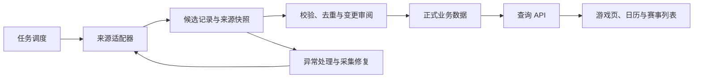

# TCG Navi 平台设计

日期：2026-11-18。状态：架构提案。

本文描述新弾ナビ向 TCG Navi 扩展的目标、数据边界、采集体系与实施顺序。技术选型和目录结构是候选方案，不代表已创建数据库、上线后端或启用定时采集。本文的提交不执行品牌、域名或数据迁移。

## 1. 产品目标与首版范围

TCG Navi 面向玩家聚合不同卡牌游戏的新品、赛事和资讯。用户既可以先选择游戏，再查看对应功能，也可以进入跨游戏的新品日历或赛事列表，再按游戏筛选。

现有新弾ナビ成为“新品日历”功能。网站继续独立于游戏门户，保留现有产品决策，界面或交互的具体调整单独设计。

首版建议继续服务日本市场，以 OPCG、PTCG 的新品与赛事验证完整链路，同时保留其他游戏已有的新品日历。资讯模块在采集、审核和来源追踪稳定后接入。

| 能力 | 当前工作区实际状态 | 目标 |
| --- | --- | --- |
| 多游戏新品日历 | Python 静态构建，商品来自 JSON，已有多游戏页面 | 保留既有数据身份，逐步接入统一查询层 |
| ONE PIECE 日本赛事 | 本地采集原型；停止采集后从真实响应缓存恢复 9,800 条不同 ID 记录；该查询来源声明总数为 13,587 | 可恢复、可核对覆盖范围的采集与入库 |
| Pokémon 赛事 | 尚未实现采集与查询链路 | 作为第二个平台来源验证可复用性 |
| 新闻资讯 | 尚未建设 | 标题、简短摘要、原文链接、关联游戏 |
| 后端与数据库 | 当前生产站仍为静态网站 | 逐步引入查询 API、业务数据库与采集执行器 |

本地部分赛事数据不是完整快照，也不是线上赛事功能。计数属于本次试验记录，不作为持续覆盖承诺。

## 2. 三个独立维度

### 2.1 游戏

为每种游戏分配内部稳定代码，例如 `OPCG`、`PTCG`、`UATCG`。代码不随显示名变化，也不复用外部平台的数字 ID。

游戏、语言版本和市场分别建模。同一游戏的日文和英文版共用游戏代码，通过版本信息区分。界面语言、商品市场、赛事所在国家也不能混为一个字段。

### 2.2 数据领域与展示功能

数据库按业务数据组织，页面功能共享数据：

| 领域 | 可支持的展示 |
| --- | --- |
| 商品与发售信息 | 新品日历、商品列表、游戏新品页 |
| 活动系列、场次与场地 | 赛事日历、赛事列表、未来的地图 |
| 资讯文章 | 游戏资讯流、主题聚合页 |

初期采用一个逻辑业务数据库、分领域建表。一个新页面不自动需要一个新数据库。

### 2.3 来源适配器

“游戏 × 功能”用作覆盖矩阵，不直接决定独立爬虫数量。实现按“来源平台 × 数据领域”复用，再通过游戏、地区和时间参数配置任务。

例如，TCG+ 赛事适配器可逐步支持多个万代游戏；同一零售商的商品适配器可覆盖多个游戏；PTCG 赛事可能需要独立的平台适配器。一个组合也可能有多个来源。

每个组合记录 `planned / experimental / active / paused` 等能力状态，以及覆盖市场、最后成功时间和已知局限。只有具备合格数据的能力才作为正式支持展示。

## 3. 总体架构



网站请求只读取已发布的数据，不触发现场抓取。采集器与查询 API 分开执行；外部来源失败时，网站保留上一次有效数据，并显示准确的更新时间和覆盖状态。

初期在同一仓库内按模块组织。保留现有 Python 构建入口；采集执行器可使用 Node.js 22 与 TypeScript，查询 API 使用适合部署平台的 TypeScript 运行时。前端框架更换不是本次平台设计的前提。

候选代码边界为 `web`、`api`、`collectors`、`contracts`、`database`。实施时再确定物理目录，不在文档阶段搬迁现有代码。

## 4. 数据模型

### 4.1 共享目录与管理数据

| 逻辑实体 | 职责 |
| --- | --- |
| `games` | 内部游戏代码、显示名、slug、官方入口 |
| `game_editions` | 游戏的语言与规则版本；市场范围单独记录 |
| `sources` | 来源平台、适配器、允许的用途、访问方式与来源优先级 |
| `source_game_mappings` | 内部游戏、版本与外部平台身份之间的映射 |
| `capabilities` | 游戏与数据领域的支持状态、覆盖和新鲜度 |
| `scrape_runs`、`scrape_checkpoints` | 任务范围、版本、进度、失败、费用和完成证据 |
| 人工修正与审阅记录 | 字段修正、依据、审核状态及变更历史 |

### 4.2 业务数据

- 商品领域：商品、官方分开的版本、发售信息，以及商品来源身份。
- 赛事领域：`event_groups`、`events`、`venues`，以及系列、场次和场地的来源身份。
- 资讯领域：文章、文章与游戏的关联、文章来源。

领域内使用有外键约束的来源映射，复用共享来源目录。不把所有数据压进一个缺少领域约束的通用 JSON 表。

### 4.3 多游戏活动

活动系列与游戏支持多对多关系，例如通过 `event_group_games` 保存关联，并区分适用语言版本与市场。

TCG+ 实测存在来源游戏为 BANDAI CARD GAMES、但系列明确关联 ONE PIECE 的共通活动。应保存一条活动及其适用游戏，不按游戏复制同一场次，也不把所有其他游戏活动直接纳入。

旧的“每个系列只能关联一个游戏”假设在平台实现前需要调整。普通单游戏系列仍只关联一个游戏。

### 4.4 身份、事实与修正

- 内部 ID 稳定；名称、时间和地点变化不生成新身份。使用经过核实的来源身份去重。
- 同名商品或同店同日多场不能仅凭名称合并。官方分开的商品版本继续分别保存。
- 语言、市场、活动地点、来源 ID 分开记录。未知字段为 null，不由游戏代码推断。
- 时间区分日期精度与时刻精度，明确时区。未知结束时间不能补成当天结束。
- 报名方式、报名状态、取消状态和个人申请资格分别处理。未来举办不等于可报名，定员不等于余位。
- 费用未知不等于免费。购买要求和参加条件应作为独立信息保留。
- 记录来源 URL、外部身份、抓取时间、来源更新时间、最后确认时间和提取方式。
- 人工修正具有明确优先级，不被后续采集覆盖；来源冲突进入审阅流程。

## 5. 数据契约与查询 API

`contracts` 模块维护版本化 JSON Schema 与对应类型，采集器、导入器、后端和前端共享契约。页面消费标准化业务字段，不依赖某个来源的 `entryFee` 等私有命名。

候选公共接口：

```text
GET /api/v1/games
GET /api/v1/capabilities?game=OPCG
GET /api/v1/releases?game=OPCG&from=2026-11-01&until=2026-12-01
GET /api/v1/events?game=OPCG&country=JP&pref=JP-13&from=2026-11-18&until=2026-12-01
```

内部查询日期使用明确的左闭右开范围；来源端是否包含结束日由适配器转换，不能直接照搬。接口限制日期范围和返回数量，使用稳定排序与游标分页。

赛事查询区分“区间内开赛”和“与区间重叠”。工作日白天筛选必须说明是在筛选开赛时间，还是要求整场处于该时段；后者在结束时间未知时不能确认。

响应除业务记录外还包含覆盖范围、最后成功更新时间和数据状态。网页日历按当前可见区间查询，不一次把全国全部赛事装入浏览器。

导入、人工修正和任务操作使用受保护的管理入口，凭据不进入公共前端。数据库写入规则与采集器权限分别管理。

## 6. 采集器协议

每个来源适配器声明：

- 支持的数据领域、游戏版本、市场与筛选范围。
- 访问方式：公开接口、HTML、浏览器，或经过授权的会话。
- 稳定身份、分页方式、排序、日期边界及完整性判断方法。
- 允许提取的字段、速率与并发限制、运行预算和异常停止条件。
- 适配器版本、输出 Schema 版本、离线样本与真实来源验收证据。

统一任务输入包含 `run_id`、来源、游戏、版本、地区、时间范围与预算；输出包含标准化记录、来源引用、检查点和覆盖报告。

来源发现与来源接入分开处理。AI 找到的新站点先登记为候选，验证来源与授权范围后才加入定时任务。

## 7. 可恢复的数据处理流程

1. **登记任务。** 固定查询范围和版本，生成范围指纹；不同游戏、日期或适配器版本的检查点不能混用。
2. **逐页保存。** 每页写入必要的脱敏快照或标准化候选记录，并保存分页位置、记录身份和检查信息。
3. **中断恢复。** 复用兼容的检查点，必要时重读重叠范围并按来源 ID 合并。浏览器缓存只作辅助证据，不承担正式进度存储。
4. **校验与核对。** 检查 Schema、身份唯一性、游戏与地区归属、时间精度、字段范围，以及来源数量和分页终止证据。
5. **审阅变更。** 新记录、改期、取消、来源冲突和异常减少分别处理。缺失或抓取失败不能直接触发删除或取消。
6. **发布合格数据。** 以经过验证的任务分区或批次更新正式数据，保留发布版本和追溯信息。

状态区分 `running / partial / failed / validated / published / stopped`。只有覆盖证据成立才能标记完整；抓取到若干页、Schema 通过或数量相等，都不能独立证明全球或全历史覆盖。

采用有限重试、超时、退避和并发控制。401、403、来源契约变化与费用超预算进入明确处理流程，不无限重试或自动扩大访问权限。

日常任务可刷新近期窗口，周期性执行较大范围审计；频率、分区大小与保留时间通过实际变更率和运行成本确定。调度不能依赖开发对话或个人电脑始终在线。

## 8. AI 的职责

AI 适合调查来源、编写与修复适配器、解析不规则内容、生成资讯摘要和辅助分析异常。稳定结构的日常抓取优先执行经过验证的程序。

AI 提取记录需要保存来源依据与提取方式，关键字段无法确认时进入待审状态。网页文本作为数据处理，不能成为代理操作指令；来源内容不能授权执行命令、读取凭据或发布变更。

浏览器程序只提取必要公开信息。来源快照按字段与用途裁剪，配置保留期，避免积累账号信息、个人资料或不必要的页面内容。

AI 不因一次成功抓取就自动生成新的生产采集代码并发布。修复需经过样本重放、实际访问验证和对应代码审阅。

## 9. 多代理协作

以下为未来实施角色，不是已经启动的团队，也不替代当前仓库授权规则。

| 角色 | 交付 | 写入边界 |
| --- | --- | --- |
| 规划协调代理 | 路线图、任务、依赖、预算与验收 | 管理任务档案，不替用户授权 |
| 数据与后端代理 | 契约、迁移、导入、查询 API | 共享数据契约与迁移指定唯一负责人 |
| 采集代理 | 来源适配器、真实样本、检查点与覆盖证据 | 按来源平台分配所有权 |
| 网站代理 | 游戏入口、日历、筛选与列表 | 页面文件单一写入者，不维护来源私有逻辑 |
| 验证代理 | 独立审阅、数据重放、端到端和恢复验证 | 独立于对应实现进行验收 |

先确定契约，再让网站与采集两条实施线并行。初期保持少量并行任务；角色可以轮换，不要求每个角色常驻一个进程。

每个任务必须包含目标、授权、输入输出、文件所有权、依赖、停止条件、验收和交接证据。隔离工作区或任务分支用于避免覆盖共享文件；不依靠对话记忆作为唯一任务档案。类型检查与包含类型检查的构建按仓库要求串行运行。

开发代理与生产调度器是两个系统。代理编写和维护代码；部署后的调度器负责持久任务、恢复和告警。子代理不能扩大父任务权限或自行批准生产变更。

## 10. 生产环境候选方案

| 组件 | 初期候选 | 选择与验收要求 |
| --- | --- | --- |
| 前端 | 保留现有 Cloudflare Pages | 渐进增加查询功能，保留既有入口 |
| 查询 API | Cloudflare Worker | 与采集执行分离，验证索引、分页和缓存 |
| 业务数据 | Cloudflare D1 | 用实际记录大小、读写量和查询验证容量与成本 |
| 来源快照 | 私有 R2 存储 | 脱敏、有限保留、可追溯和可重放 |
| 浏览器执行器 | 托管浏览器或独立容器 | 先验证实际来源访问、会话、恢复与运行成本 |
| 后续任务分发 | 根据负载评估 Queues | 出现具体并发、重试或任务积压需求时接入 |

本机 Chrome 成功不代表云端或无头浏览器可用。Cloudflare Browser Run 是候选，需要使用实际 TCG+ 任务单独验证；不预先承诺兼容性或免费运行。

生产、预览和本地环境分别配置数据与凭据。公共站点无采集写权限；采集任务只获得所需的候选数据写权限。上线前核实官方限制、预算和恢复方式，再创建资源。

代码部署、采集运行、候选入库和正式数据发布是不同授权。当前 main push 会触发生产部署；未来任何流程变化都需单独批准。自动数据刷新不能混入现有构建 workflow。

## 11. 渐进迁移与品牌

- 保留商品 ID 与人工 overrides；迁移前核对构建实际使用的修正、收藏与来源身份逻辑，不按过时说明重建 ID。
- 现有其他游戏新品能力持续保留；新后端先用少量游戏验证，避免一次性改写全部页面与数据流程。
- TCG Navi 作为平台品牌，新弾ナビ作为新品功能延续。品牌、导航、视觉和域名变更单独审阅。
- 现有已收录 URL 建立明确映射；最终路径、canonical、重定向与 sitemap 在迁移时统一核对，避免批量改变有效入口。
- 资讯首版使用标题、简短摘要与原文链接，明确来源与发布时间；商品信息与资讯文章分别建模。
- 本次设计不引入游戏门户互链，也不改变现有生产域名或 Cloudflare 规则。

## 12. 实施里程碑

| 阶段 | 主要交付 | 完成标准 |
| --- | --- | --- |
| M0 平台设计 | 本文、能力矩阵、契约与待决事项 | 范围、数据归属、来源复用与责任边界得到确认 |
| M1 ONE PIECE 数据闭环 | 可恢复采集、候选存储、审阅和导入 | 中断后保留进度；重跑不重复；覆盖证据可信；失败保留旧数据 |
| M2 查询与页面闭环 | 本地或预览数据库、API、新品与赛事页面 | 玩家按游戏、地区、日期查到可与来源逐项核对的场次 |
| M3 接入 PTCG | 第二个赛事平台与对应标准化映射 | 验证跨来源复用；无需复制数据库、API 和整套页面 |
| M4 平台发布与扩展 | 品牌迁移、更多游戏与后续资讯 | URL 迁移和生产验证通过；按实际能力逐步开放 |

每个里程碑单独确认。前端可在契约稳定后用明确标记的样本并行开发；样本通过不计为真实来源验收。

## 13. 首轮必须验证的场景

- 商品改期、同商品不同版本与人工修正继续生效。
- 同店同日多场、同名门店、共通多游戏活动与单场延期保持正确身份。
- 线上活动、日期已知而时刻未知、结束时间未知、费用和报名状态未知。
- 部分页失败、源总数变化、重复页、来源中断与检查点版本不兼容。
- 页面只展示已发布范围，并显示准确的新鲜度；旧数据不被误报为实时可报名。
- 数据库重复导入、批次发布与恢复不会覆盖无关数据。
- 数据和日志中不包含浏览器 profile、凭据或不必要的个人信息。

## 14. 待确定事项

1. 首版是否正式采用“日本市场、OPCG/PTCG、新品与赛事”的范围。
2. 数据新鲜度目标、采集频率、来源覆盖、保留时间与月度预算。
3. 浏览器执行环境的实际可行性，以及数据库容量和查询性能的测量结果。
4. 哪些稳定任务可自动写候选区、哪些变更可自动发布、哪些必须审阅。
5. TCG Navi 的最终日语名称、视觉、域名与现有路径迁移策略。

## 15. 参考

- [现有项目说明](../README.md)：当前静态构建与数据维护方式。
- [当前部署 workflow](../.github/workflows/deploy.yml)：实际 main push 行为以此为准。
- [Cloudflare D1](https://developers.cloudflare.com/d1/) 与 [限制](https://developers.cloudflare.com/d1/platform/limits/)：关系数据候选。
- [Cloudflare R2](https://developers.cloudflare.com/r2/)：快照对象存储候选。
- [Cloudflare Browser Run](https://developers.cloudflare.com/browser-run/)：托管浏览器候选。
- [Cloudflare Queues](https://developers.cloudflare.com/queues/)：后续任务分发候选。
